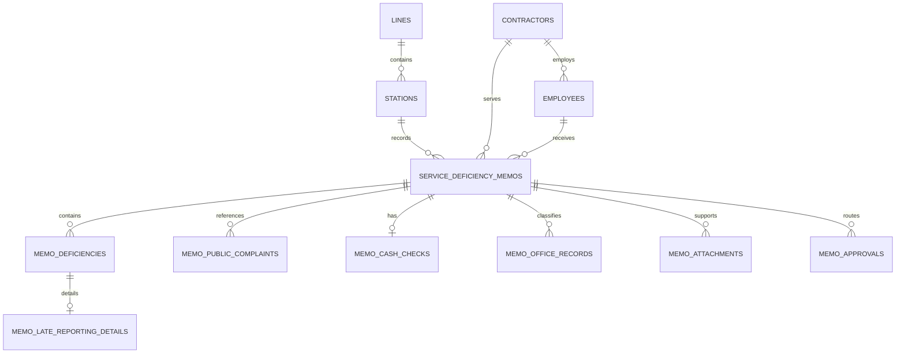

# Service Deficiency Memo database structure

This schema supports both source forms:

- Token Vending Services (`token_vending`)
- Customer Facilitation Services (`customer_facilitation`)

The application presents these values as `TICKETING` and `CFS`. Lines are maintained
as master records and stations reference them through `line_id`; the original
`stations.line` text is retained only for safe legacy-data migration.

Both formats use `service_deficiency_memos` as their common header. Optional and
repeatable sections are stored separately so the Customer Facilitation form does
not carry empty Token Vending cash-check fields.

## Form-to-table mapping

| Form section | Storage |
|---|---|
| Serial number, service, station/line, contractor, staff, employee/work ID, incident date and brief remarks | `service_deficiency_memos` plus master records |
| Suitable action recommended | `service_deficiency_memos.recommended_action` |
| Late reporting | `memo_deficiencies` and `memo_late_reporting_details` |
| Dress code/failure to follow instructions | `memo_deficiencies` |
| Misbehavior with customer/staff | `memo_deficiencies` |
| Public complaint number and station | `memo_public_complaints` |
| Other discrepancy | `memo_deficiencies` |
| TOM/CCC inspection and cash-check details (Token Vending only) | `memo_cash_checks` |
| Office record grid (Token Vending only) | `memo_office_records` |
| Supporting documents | `memo_attachments` |
| Station seal and date | `service_deficiency_memos.station_seal_path` and `station_sealed_at` |
| SM, line manager, operations, contracts and DGM signatures | `memo_approvals` |

Names and identifying numbers are copied onto each memo as historical snapshots,
while optional foreign keys link to the current contractor and employee master
records. A serial number is unique within a service type. Cash difference uses a
positive value for excess and a negative value for shortage.
